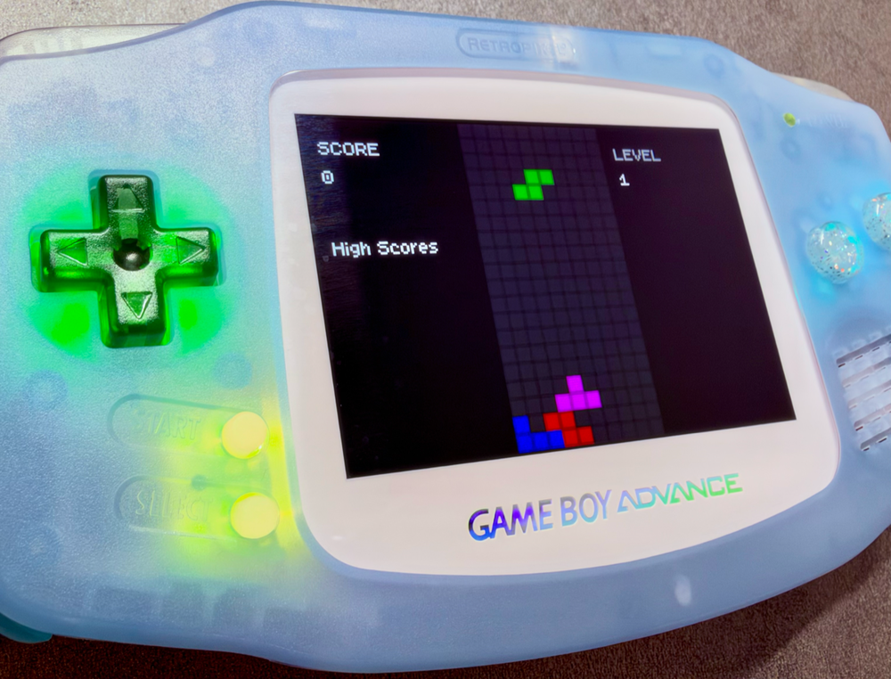

# txustris.gba

When I was learning Ruby in the summer of 2009, I wrote [Txustris, a Tetris clone](https://github.com/txus/txustris) using the Gosu library.

17 years later, I took an interest in the GameBoy Advance as a software platform, and how to program games for it in Zig, with a decent developer experience. This is the result!



Download the latest ROM from [Releases](https://github.com/txus/txustris.gba/releases) and open it in any GBA emulator (or a flashcart).

## Controls

| Button | Action |
| --- | --- |
| Start | Start a game (title screen, game over) |
| ← / → | Move (hold to auto-repeat) |
| ↓ | Soft drop |
| A / B | Rotate clockwise / counterclockwise |
| Select | Pause / resume |

## Requirements

- **Zig 0.17.0** (the version in `build.zig.zon`; [anyzig](https://github.com/marler8997/anyzig) picks it automatically)
- **ffmpeg** on your `PATH`: the build converts `assets/music.ogg` to raw PCM
- **mGBA** on your `PATH`: for `zig build run` and debugging
- **lldb**: ships with Xcode (`xcrun lldb`, `xcrun -f lldb-dap`)

Dependencies (ziggba) are fetched by `zig build` on first use into `zig-pkg/`.

## Day to day

### Build

| Command | Mode | Use it for |
| --- | --- | --- |
| `zig build` | ReleaseFast | the real game, like released from CI |
| `zig build -Dsafe` | ReleaseSafe | playtesting: optimized, but integer overflow and out-of-bounds panic instead of silently corrupting things |
| `zig build -Ddebug` | Debug | stepping through code in a debugger |

Outputs land in `zig-out/bin/`: `txustris.gba` (the ROM) and `txustris` (the ELF with symbols, for lldb and `objdump`).

Debug builds behave a little differently on purpose:

- the board starts with a test scenario (`setDebugScenario` in `Game.reset`) so line clears are one drop away
- the RNG keeps its fixed seed, so every debug run deals the same pieces

### Run

```sh
zig build run           # build, install, and open zig-out/bin/txustris.gba in mGBA
zig build run -Dsafe    # same, with safety checks on
```

### Debug

**From Neovim** (nvim-dap, config in `.vscode/launch.json`): `<leader>dc` and pick **mGBA (attach :2345)**. `tools/mgba.py` rebuilds with `-Ddebug`, kills any old mGBA, starts a fresh one with its GDB stub on `:2345`, and attaches. mGBA starts paused, so press `<leader>dc` again to run.

| Key | Action |
| --- | --- |
| `<leader>db` / `<leader>dB` | toggle breakpoint / conditional breakpoint |
| `<leader>dc` | start / continue |
| `<leader>dP` | pause (find out where a hang is) |
| `<leader>dO` / `<leader>di` / `<leader>do` | step over / into / out |
| `<leader>dj` / `<leader>dk` | move down / up the call stack |
| `<leader>du` | toggle the dap UI |
| `<leader>dt` | terminate |

**From a terminal:** `lldb -s gba.lldb` does the same (build, launch mGBA, attach). `zig build debug` only launches a paused mGBA waiting on `:2345`.

Every session sets a breakpoint on `debug_panic.panic`, so a safety panic stops with the full stack. Move down the stack to reach your own code.

**Decoding a `PANIC @ 080005F3` address** from the mGBA screen (clear the low bit: odd addresses are Thumb code):

```sh
xcrun lldb --batch \
  -o "target create --arch armv4t-none-eabi zig-out/bin/txustris" \
  -o "image lookup -v -a 0x080005F2"
```

Build with the same mode that panicked (`-Ddebug` or `-Dsafe`) so the ELF matches the ROM.

### Logging

```zig
gba.debug.print("lines: {d}", .{lines}) catch {};
```

Shows up in mGBA under **Tools → View Logs** (level Info, category "GBA Debug"). Log events, not every frame: 60 lines a second buries everything.

### mGBA tools worth knowing

| Tool | What it answers |
| --- | --- |
| Audio/Video → Video layers | is the bug in a background or in the sprites? Toggle BG0, BG1, OBJ |
| Tools → View Sprites / Map / Tiles / Palette | what is actually in OAM, the tilemaps, VRAM, palette RAM |
| Tools → View Memory | raw memory, e.g. the save at `0x0E000000` |
| Ctrl+N | advance one frame (hold a direction while pressing it to test DAS timing) |
| Shift+F1 / F1 | save / load state 1, to repeat a tricky setup instantly |

### Saves

High scores live in battery-backed SRAM. mGBA keeps the save next to the ROM: `zig-out/bin/txustris.sav`.

- Delete it to test a fresh cartridge.
- Corrupt a byte to check that the checksum rejects it and the scores reset.
- `rm -rf zig-out` deletes your saves too.

Layout (`SaveData` in `src/main.zig`): magic `TXRS`, five `u32` scores (little-endian), version byte, XOR checksum (seed `0xA5`), padding.

Emulators and flashcarts detect the save chip by finding the string `SRAM_V113` in the ROM. To check it survived the linker:

```sh
LC_ALL=C grep -obUa SRAM_V113 zig-out/bin/txustris.gba   # offset should be divisible by 4
```

## Releases

`.github/workflows/build.yml` builds the ROM on every push and pull request, and uploads it as a workflow artifact.

Every push to `main` also publishes a GitHub release with the ROM attached:

- The version is the latest `vX.Y.Z` tag with the patch number bumped. The first release is `v0.1.0`.
- For a minor or major bump, run the workflow by hand: **Actions → build → Run workflow**, then pick `minor` or `major`.
j To push without releasing, put `[skip release]` in the commit message.
